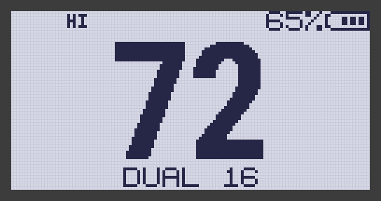
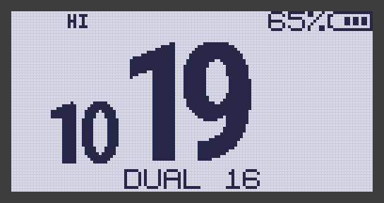

# Marine VHF for F4HWN Fusion

 

An IC-M94-style marine VHF app for the Quansheng UV-K1 / UV-K5 V3 running the
[F4HWN firmware](https://github.com/armel/uv-k1-k5v3-firmware-custom) (Fusion edition):
big channel number, channel 16 dual watch, and only the international channels of ITU
Radio Regulations Appendix 18.

## Install

Download `MarineVHF.app` from [Releases](../../releases/latest) and install it in a free
slot with UV Studio (Apps). At its first start the app sets the VFO to channel 16 and
restarts. Dual watch needs the squelch set above 0.

## Keys

| UV-K5 V3 | UV-K1 | |
|---|---|---|
| UP / DOWN | RIGHT / LEFT | Channel up / down (hold to scroll) |
| 0-9 | 0-9 | Channel number (1, then a pause: 01) |
| MENU | MENU | Channel 16 / back |
| * | * | HI / LO power |
| F | F | Dual watch on / off |
| SIDE1 | SIDE1 | Monitor (hold) |
| EXIT | EXIT | Quit |

## Build

```sh
cp -r app/marine <firmware>/App/apps/marine
cd <firmware>/App/apps/marine && ./build.sh      # needs arm-none-eabi-gcc, python3
```

More: [guide](docs/guide.md), [channel plan](docs/channel-plan.md),
[how it works](docs/how-it-works.md).

Experimental. Transmitting on marine VHF requires a licence; `MARINE_TX=0 ./build.sh`
builds a receive-only app.

## License

Apache 2.0 ([LICENSE](LICENSE)). The digits are rendered from Roboto Condensed, SIL OFL 1.1
([fonts/OFL.txt](fonts/OFL.txt)).

Coded using Claude Opus v5.5.
