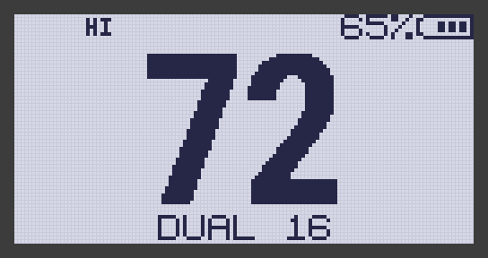
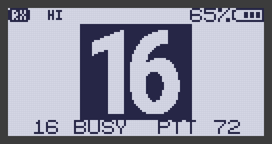
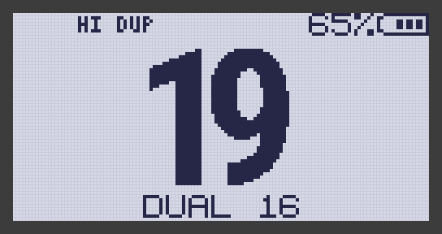
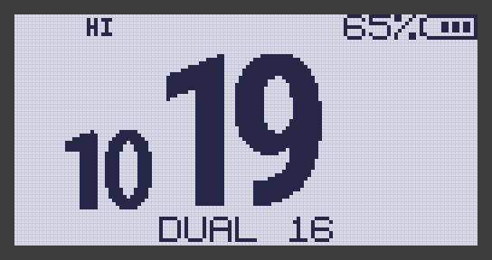
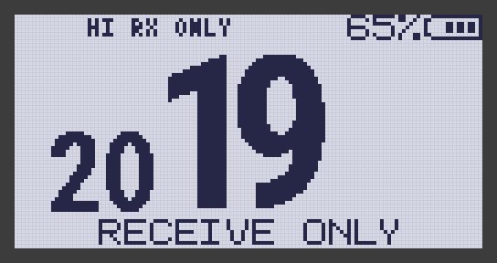
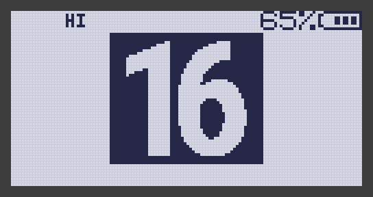
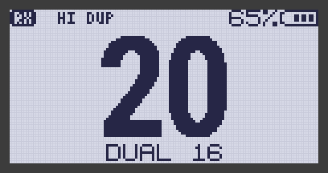
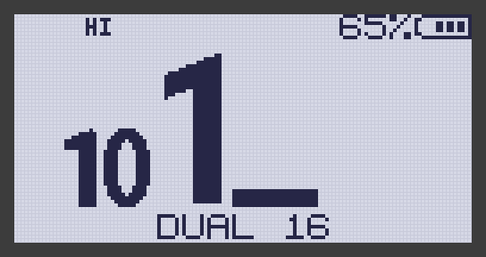

# Marine VHF: full guide

 

An overlay app that turns a Quansheng UV-K1 or UV-K5 V3 running the
[F4HWN custom firmware](https://github.com/armel/uv-k1-k5v3-firmware-custom) (Fusion
edition) into a marine VHF handheld in the style of the Icom IC-M94: the channel number in
big digits, channel 16 dual watch on every channel, and the international channel plan.

- **International channels only**: ITU Radio Regulations Appendix 18 (Rev.WRC-19), 58
  channels, none of the national or regional ones (no USA/Canada "A"/"B" channels, no
  L1-L3, no M1/M2, no private channels). See [channel-plan.md](channel-plan.md).
- **Duplex**: on the 25 two-frequency channels of Appendix 18 the radio receives on the
  coast frequency and transmits on the ship frequency, 4.6 MHz lower.
- **Dual watch**: channel 16 is checked every 1.6 s on whatever channel is selected, each
  look lasting about 110 ms (EN 301 025-1: at least every 2 s, at most 150 ms). A signal
  on 16 holds the radio there, beeps twice and blinks "16".
- **IC-M94-style keys**: 16/back key, HI/LO, direct channel entry.
- **Power rules**: selecting 16 sets HI; 75 and 76 are held at LO (1 W); 70 (DSC), AIS and
  ASM cannot be selected; the 2xxx channels are receive-only.
- Big, legible digits (Roboto Condensed Bold, as a bitmap in the app's assets).
- Fits in the 4 KiB overlay: 3628 B with its RAM (89 %), plus 1826 B of font assets.

## Install

1. Build the app (below), or download `MarineVHF.app` from the Releases page.
2. In **UV Studio**, Apps, install `MarineVHF.app` into a free slot.
3. Start it from the Apps menu.

At the first start the VFO is usually not on a marine channel. The app then puts the VFO
on channel 16 (156.800 MHz, FM, wide, no CTCSS/DCS) and starts again by itself: that VFO
is what sets up the VHF front end, the 25 kHz filters, the PA calibration and the radio's
own TX checks for the marine band. The VFO stays on 156.800 MHz after you leave the app.
See [how-it-works.md](how-it-works.md).

Set the radio's squelch (SQL) above 0 before you start: dual watch needs it.

## Keys

| UV-K5 V3 | UV-K1 | Action |
|---|---|---|
| UP / DOWN | RIGHT / LEFT | Next / previous channel; held, it repeats after 1 s |
| 0-9 | 0-9 | Channel entry, like a TV remote (below) |
| MENU | MENU | Channel 16; again: back to the previous channel (the IC-M94's 16/C key) |
| * | * | HI / LO power |
| F | F | Dual watch on / off |
| SIDE1 (hold) | SIDE1 (hold) | Monitor (squelch open) |
| PTT | PTT | Transmit on the displayed channel |
| EXIT | EXIT | Quit |

The arrow keys follow the radio's SetNav setting, as everywhere else in the firmware.

Channel entry: the digits appear in the big digits as you type them. A channel is taken as
soon as no other channel begins with what you typed (3 → 03, 72 → 72, 1019 → 1019), else
after a 1 s pause (1 → 01, 10 → 10, 20 → 20). Typing that matches no channel shows NO SUCH
CHANNEL; PTT drops a channel being typed.
While transmitting, the other keys do nothing (no channel change under PTT).

## Display

  
  

Status line: TX / RX / MON, HI or LO, DUP (duplex) or RX ONLY, battery. Middle: the
channel, channel 16 in inverse. A four-digit channel is shown as on the IC-M94: its last
two digits exactly where the two-digit channel is, and the 10 or 20 smaller in front, on
the same baseline (so scrolling 19, 1019, 2019 only changes the small prefix). While you
type a channel: the digits so far and a blinking underscore. Bottom: "DUAL 16" while dual
watch is on, "16 BUSY  PTT nn" while a signal on 16 holds the receiver (PTT still
transmits on channel nn), or a short message (RECEIVE ONLY, TX LOCKED, BATTERY LOW, TX
TIMEOUT, NO SUCH CHANNEL).

## Transmitting

PTT transmits on the displayed channel's ship frequency, at HI (about 5 W) or LO (about
0.5 W; always on 75 and 76). It is refused on receive-only channels, and when the radio
itself would refuse to transmit on a marine frequency: with an F Lock profile that does not
include 156-157 MHz (CE, FCC, GB, PMR...) the app shows TX LOCKED. A transmission is cut
after 5 minutes.

Transmitting on marine VHF needs a ship station licence and an operator certificate (SRC
or equivalent) in most countries, and usually type-approved equipment, which these radios
are not. `MARINE_TX=0` builds a receive-only app.

## Build

The app builds inside the firmware tree, like the in-tree apps:

```sh
git clone https://github.com/armel/uv-k1-k5v3-firmware-custom.git
cd uv-k1-k5v3-firmware-custom
cp -r /path/to/this/repo/app/marine App/apps/marine
./compile-app.sh marine          # Docker; or: cd App/apps/marine && ./build.sh
```

The folder must be named `marine`. `./build.sh` needs `arm-none-eabi-gcc` and `python3`
(no Python packages: `gen_assets.py` packs `digits.txt` and `digits_small.txt`, the font
bitmaps, into the assets).
The result is `App/apps/marine/MarineVHF.app`. It requires API level 4 and the BEAM
bridge (`--require beam2`), both in the Fusion edition.

Options (environment variables for `build.sh`):

| Option | Default | |
|---|---|---|
| `MARINE_TX` | 1 | 0: receive-only |
| `MARINE_VDES_VOICE` | 0 | 1: also 24, 25, 26, 84, 85, 86 as duplex voice channels |
| `MARINE_LOW_15_17` | 0 | 1: also hold 15 and 17 at low power |

## Tests

```sh
python3 tools/check_channels.py            # the channel table against Appendix 18
python3 tools/screenshots.py --fw /path/to/uv-k1-k5v3-firmware-custom
```

`check_channels.py` builds the channel code for the PC and checks every entry against
`tools/app18_reference.csv`, Appendix 18 typed in row by row. `screenshots.py` runs the
built app in the firmware's own overlay emulator (`App/apps/app_screenshot.py`, needs the
Fusion firmware built and `pip install unicorn pyelftools`), saves the screens in
`docs/img` and checks dual-watch timing, the TX sequence, the keys and the VFO staging.

## Limitations

- **Not tried on a radio yet.** Everything above was checked in the emulator only. The
  values most likely to need adjusting on the air are the dual-watch settle time and read
  count (squelch speed after a retune) and the 20 ms PLL wait before the PA.
- UV-K5 V3: untested, but the app uses only the shared API.
- Not implemented from the IC-M94: DSC, tri-watch, scanning and favourites, key lock,
  channel names, weather channels, the national channel groups.
- An app launched from the Apps menu replaces the radio's own dual watch / Full Watch
  while it runs.

## The font

The digits are Roboto Condensed Bold, rendered at 44 pixels (`app/marine/digits.txt`) and
at 22 pixels for the 10/20 prefix of the four-digit channels (`digits_small.txt`, whose 0
was retouched by hand), kept as text art ('#' = pixel). To render them again, or from
another font: `python3 tools/render_digits.py FONT.ttf [--weight 700] [--small]` (needs
Pillow; `--preview out.png` shows 16, 72, 05...).

## License

Apache License 2.0, as the F4HWN firmware. See [LICENSE](../LICENSE) and [NOTICE](../NOTICE).
The digit bitmaps come from Roboto Condensed, under the SIL Open Font License 1.1
([fonts/OFL.txt](../fonts/OFL.txt)).
Thanks to Armel F4HWN and all contributors of the UV-K5/UV-K1 open firmware projects.
